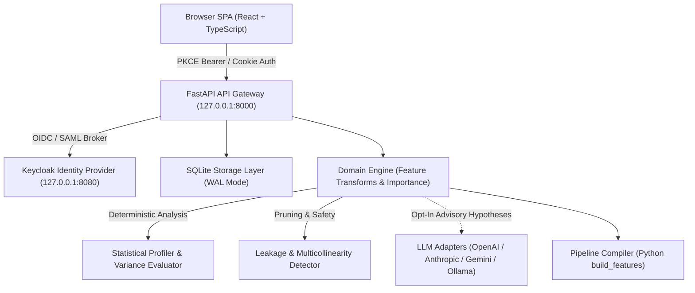

# ML Feature Forge — Alan Vo | AI & Machine Learning

> Work in progress. This checkpoint may be incomplete or fail tests. See PLAN.md and STATUS.md before use.


ML Feature Forge addresses the bottleneck of manual feature engineering in machine learning by pairing automated statistical signal ranking with opt-in LLM hypothesis generation to discover, prune, and export robust tabular feature pipelines for data scientists and ML engineers. The platform combines a deterministic offline engine with multi-provider LLM support to prevent data leakage, prune multicollinearity, and generate production-ready Python pipelines.

## Architecture



## Key Workflows & Features

1. **Tabular Dataset Ingestion & Profiling**: Automated type inference (`numeric`, `categorical`, `datetime`), null-rate accounting, summary statistics, and target analysis.
2. **Deterministic Feature Synthesis**:
   - Non-linear transforms: `log1p(x)`, standard scaling z-scores, 5-tier quantile binning.
   - Interaction effects: pairwise density ratios `x / (y + eps)` and multiplicative synergies `x * y`.
   - Categorical encodings: relative frequency encoding and Bayesian smoothed target encoding.
   - Datetime temporal features: cyclical sine/cosine annual seasonality and weekend indicators.
3. **Opt-in Advisory LLM Hypotheses**: Context-grounded hypothesis generation across four configurable adapters, strictly advisory and validated against target leakage.
4. **Statistical Quality & Leakage Gate**: Pearson correlation ranking against target outcome, automated data leakage pruning (e.g. `|r| >= 0.999` or target input inclusion), and multicollinearity detection (`|r| >= 0.85`).
5. **Reproducible Code Generation**: Automatic compilation of kept features into a self-contained, vectorized `build_features(df)` Python function and JSON specification.
6. **Enterprise Authentication**: Keycloak OIDC authorization code flow with PKCE, RBAC (`viewer`, `analyst`, `admin`), local-only demo mode, and transactional audit logging.

## API Endpoint Reference

| Method | Path | Required Role | Description |
|---|---|---|---|
| `GET` | `/api/health` | Public | Service healthcheck and version metadata |
| `GET` | `/api/system/info` | Public | System status, author metadata, and provider settings |
| `GET` | `/api/auth/config` | Public | Keycloak OIDC issuer details and demo mode status |
| `POST` | `/api/auth/demo-login` | Public (Dev only) | Issue demo bearer token for local development |
| `POST` | `/api/auth/callback` | Public | Keycloak authorization code exchange with PKCE |
| `GET` | `/api/auth/me` | `viewer` | Retrieve current authenticated user profile |
| `GET` | `/api/datasets` | `viewer` | List all ingested datasets |
| `POST` | `/api/datasets` | `analyst` | Ingest and profile a new tabular CSV dataset |
| `POST` | `/api/datasets/demo-load`| `analyst` | Seed credit assessment demo dataset |
| `GET` | `/api/features/{dataset_id}` | `viewer` | List candidate features for dataset |
| `POST` | `/api/features/propose` | `analyst` | Propose deterministic and advisory candidate transforms |
| `POST` | `/api/evaluations` | `analyst` | Evaluate importance, multicollinearity, and leakage |
| `GET` | `/api/pipelines` | `viewer` | List compiled feature pipelines |
| `POST` | `/api/pipelines` | `analyst` | Compile kept features into Python pandas pipeline code |
| `GET` | `/api/audit` | `analyst` / `admin` | Inspect immutable audit log ledger |

## AI/ML Evaluation

To evaluate feature signal discovery on the credit loan assessment benchmark:

```bash
# Reproducible evaluation command
PYTHONPATH=. .venv/bin/python main.py forge --data ./credit_sample.csv --target approved
```

- **Data Provenance**: 20-row reference credit dataset containing customer age, income, credit score, debt-to-income ratio, employment duration, and tier.
- **Baseline**: Raw Pearson signal against the `approved` target — `debt_to_income` |r| = 0.833, `credit_score` |r| = 0.751, `income` |r| = 0.708, `age` |r| = 0.675.
- **Measured Results** (deterministic engine; `collinearity_threshold=0.85`, `min_importance_threshold=0.02`): of 32 generated candidates, 2 survive pruning and are exported — `log1p_age` (|r| = 0.737, up from raw `age` |r| = 0.675 after skew compression) and `ratio_income_per_loan_amount` (|r| = 0.240). The raw numeric predictors are highly mutually collinear, so most transforms and interactions are pruned as redundant rather than signal-weak.
- **Target Encoding**: `target_mean_city_tier` reaches |r| = 0.700 but is pruned as collinear with the ratio interactions. The compiled pipeline expression is a self-contained `groupby().transform()` (Bayesian-smoothed mean, smoothing = 5.0) and is runtime-verified by `backend/tests/test_pipeline_generation.py`.
- **Failure Cases & Limitations**: Highly skewed power-law distributions with zero counts require clipping before log transforms. Small sample sizes (< 50 rows) can overestimate Pearson correlation; production training should validate candidate importance using cross-validated feature ablation on test holdouts.

## LLM Provider Configuration

The core feature engine operates entirely offline without an LLM key. Opt-in advisory reasoning can be configured using environment variables:

| Setting | Variable | Default | Notes |
|---|---|---|---|
| API Key | `LLM_API_KEY` | *(blank)* | Sole credential variable; stored only server-side |
| Provider | `LLM_PROVIDER` | `openai-compatible` | Options: `openai-compatible`, `anthropic`, `gemini`, `ollama` |
| Model | `LLM_MODEL` | `gpt-4o-mini` | Operator-chosen model |
| Base URL | `LLM_BASE_URL` | *(provider default)* | Custom base URL (e.g. OpenRouter or local Ollama) |

## Single Sign-On (SSO) and Keycloak SAML Setup

Authentication is handled via Keycloak OIDC authorization-code flow with PKCE (`S256` code challenge). Upstream corporate SAML identity providers are supported through Keycloak identity brokering:

1. Import `keycloak/realm-export.json` into your Keycloak instance.
2. In the Keycloak Admin Console, navigate to **Identity Providers** &rarr; **Add provider** &rarr; **SAML 2.0**.
3. Supply your corporate SAML IdP Entity ID, Single Sign-On Service URL, and X.509 signing certificate.
4. Map SAML assertion attributes (`email`, `username`, and group memberships) to realm roles (`viewer`, `analyst`, `admin`).
5. Set `OIDC_ISSUER_URL` in `.env` to point to `http://localhost:8080/realms/feature-forge`.

## Security Limitations

- **Local Demo Mode Guardrail**: Demo mode binds strictly to localhost. If `APP_ENV=production`, the application refuses startup if demo mode is enabled.
- **Credential Storage**: Bearer tokens are maintained in-memory only by the SPA client. Tokens are never stored in `localStorage`.
- **Token Logging**: Authorization tokens are strictly excluded from all application logs and error diagnostics.

## Quickstart & Installation

```bash
# 1. Backend environment setup
python3 -m venv .venv
.venv/bin/pip install -r backend/requirements.txt
PYTHONPATH=backend .venv/bin/python -m pytest backend/tests

# 2. Frontend setup and build
cd frontend
npm ci
npm run build
npm test
cd ..

# 3. Launch via Docker Compose (Keycloak, Backend, Frontend)
docker compose up -d
```

---

Maintainer: **Alan Vo** &lt;[alanvo@gmail.com](mailto:alanvo@gmail.com)&gt;  
License: [MIT License](LICENSE)
